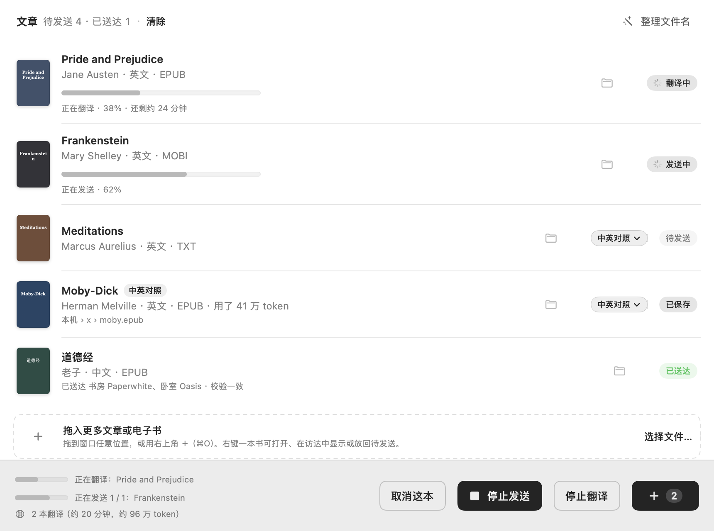
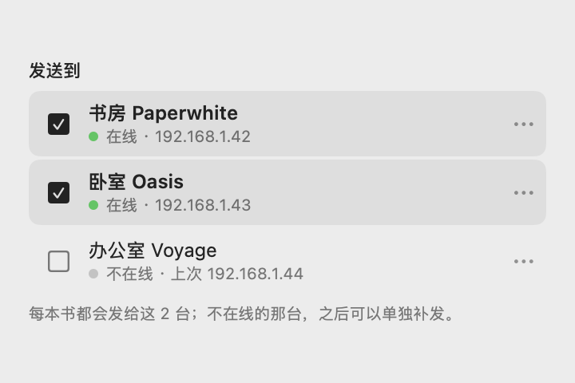
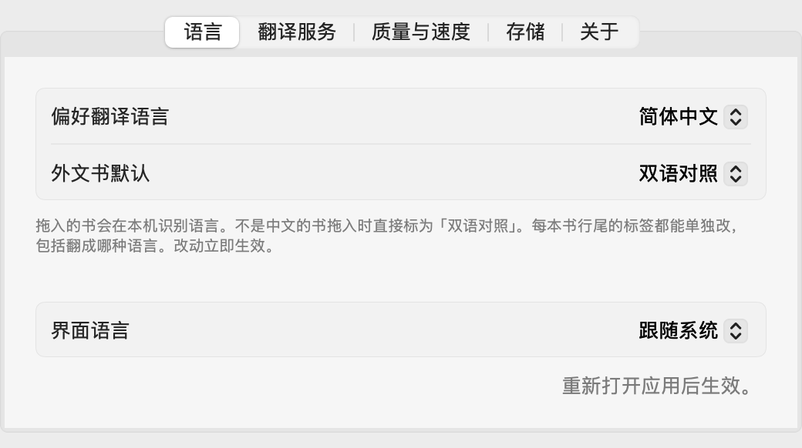
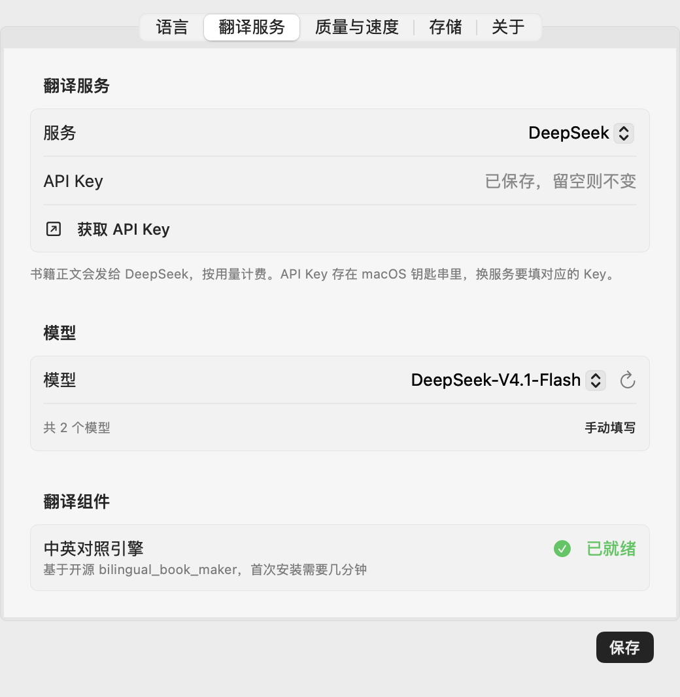
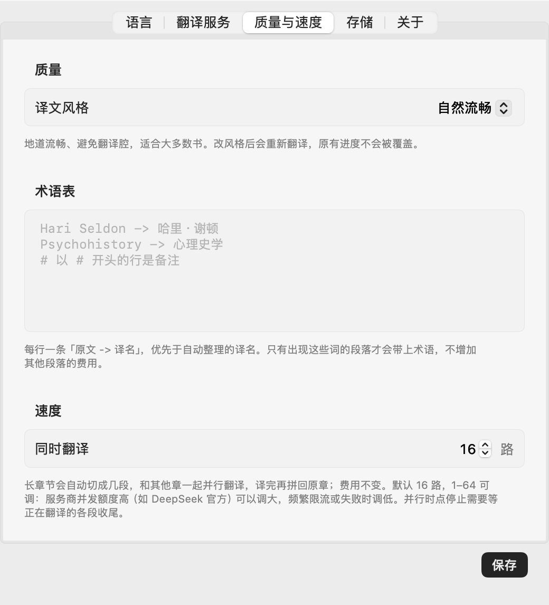
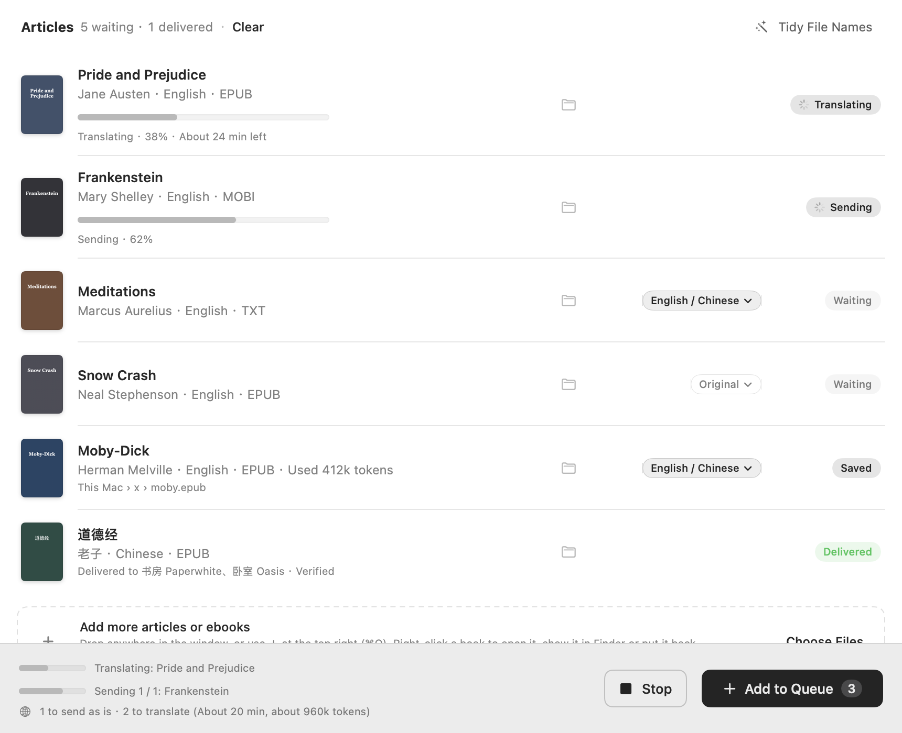

<p align="center"></p>

<h1 align="center">乔木 Kindle 助手</h1>

<p align="center">把文章和电子书变成适合阅读的版本，翻译成中文对照，再通过 Wi-Fi 发到 Kindle，或只保存在本机。</p>

<p align="center"><a href="https://github.com/joeseesun/kindle-push-macos/releases/latest">下载最新版</a> · <a href="docs/SETUP.md">首次配置</a> · <a href="docs/TRANSLATION.md">双语翻译</a> · <a href="docs/FORMATS.md">格式支持</a> · <a href="docs/TROUBLESHOOTING.md">常见问题</a></p>

<p align="center"></p>

这个应用最早由 [chasepal](https://github.com/chasepal/kindle-push-macos) 开发：原作者看了我分享的 Kindle / KOReader 读书方式，写了这个 Mac 端的配套工具。我在它的基础上加了外文书翻译、多台 Kindle、保存到本机、整理文件名等功能。原作者的署名、许可和传输协议都保留；翻译引擎是 MIT 开源的 [bilingual_book_maker](https://github.com/yihong0618/bilingual_book_maker)。

文章在 Obsidian 或本地文件夹里写好，拖进应用、点发送，就能在 Kindle 上慢慢读。直接发送不经过云端；只有选了翻译，正文才会发给你设置的翻译服务。

它通过 KOReader 自带的 SSH 服务传文件，**不需要安装我做的 [乔木 SimpleUI](https://github.com/joeseesun/qiaomu-simpleui)，也不包含越狱工具**。

## 能做什么

- **KOReader 能读的都能发**：EPUB、PDF、XPS、DjVu、CBZ/CBR/CBT 漫画、MOBI/AZW/AZW3/PRC/PDB、FB2/FB3、CHM、DOC、压缩的 fb2.zip/txt.zip 等原样发送；带 DRM 的 MOBI/AZW 会提前提示。
- **转换后再发**：Markdown、TXT、HTML、Word（DOCX）、ODT、RTF 转成带目录的 EPUB。TXT 自动识别 GBK/GB18030 编码，把「第一章」「Chapter 1」这类行变成章节标题。
- **Markdown → EPUB**：保留标题、作者、目录、列表、表格、代码和脚注，加入适合小屏阅读的样式。
- **Obsidian 支持**：双链转为显示文字，图片打包到 EPUB，支持整篇笔记嵌入和提示块。
- **拖放与批量发送**：整个窗口都能拖入，记录发送结果，失败可重试。翻译和普通发送分两条队列同时进行，长时间翻译时其他书照常发送、保存和整理。
- **只保存到本机**：不连 Kindle 也能用，点「保存到本机」（有书要翻译时按钮叫「翻译并保存」），结果在访达中选中。
- **换 Wi-Fi 后寻找设备**：先尝试上次地址，再寻找已配对的 Kindle；也可手动填写 IP。
- **发送后校验**：读回远端 EPUB，比较 SHA-256，确认传输一致。
- **整理文件名**：去掉 z-library、1lib 等来源标记、下划线和多余空格、「2017 最新版」「第二版」这类后缀。发到 Kindle 和保存到本机的文件自动用干净的名字；「整理文件名…」（⌘E）还能预览、逐个修改后重命名原文件，可选「智能精简」只留主书名、「保守清理」保留副标题，也可以加上作者。只处理电子书，笔记和文档保留原名。
- **原文不改动**：只读选择的文章及其引用附件，转换副本保存在本机；只有在「整理文件名」里确认后才会重命名原文件。
- **外文书翻译**（EPUB、TXT、Markdown、HTML、Word、ODT、RTF、FB2；装了 Calibre 还能译 MOBI/AZW）：拖入时在本机识别书的语言，外文书在列表上方一键选「中英对照」（原文与译文逐段对照）或「仅中文」，每本书行尾的标签可单独改；每本书都能单独选翻成哪种语言（English、日本語、繁體中文等 20 种），设置里的只是偏好；不接 Kindle 也能翻译后保存到本机。右键可先试译 3 段，原文书直接发、要翻译的书译完自动发；保留图片与目录。支持取消、恢复检查点和复用已完成译本；失败或取消的译本不自动发送。
- **简单的模型设置**：选服务、填 Key（或登录），再从自动读取的模型列表里选；支持 ChatGPT 账号登录、OpenRouter 和词元跳动浏览器授权。
- **更快、更好的译文**：长章节自动拆段，默认 16 路并行（1–64 可调），费用不变；四种译文风格（自然流畅、忠实准确、文学润色、技术学术）；开译前自动整理全书人名和术语，也可以自己填术语表，各章译名统一。

## 界面一览

<table>
<tr>
<td width="50%"></td>
<td width="50%"></td>
</tr>
<tr>
<td><b>发给几台 Kindle</b><br>连接面板里勾选，每本书发给勾选的每一台；不在线的那台之后可以单独补发。</td>
<td><b>语言</b><br>外文书拖入时自动识别，按这里的偏好标成「中英对照」或「仅中文」；界面可选中文或英文。</td>
</tr>
<tr>
<td></td>
<td></td>
</tr>
<tr>
<td><b>翻译服务</b><br>选服务、填 Key，模型列表自动读取。Key 存在 macOS 钥匙串。</td>
<td><b>质量与速度</b><br>四种译文风格、自填术语表，长章节拆段并行翻译。</td>
</tr>
</table>

## 使用条件

| 项目 | 要求 |
| --- | --- |
| Mac | macOS 14 或更新。Apple 芯片版已实测；Intel 版（`KindlePush-Intel.dmg`）只验证了打包和公证，未在 Intel Mac 上运行过 |
| Kindle | 已越狱、已经安装并运行过 KOReader，包含 SSH / Dropbear 插件 |
| 网络 | Mac 和 Kindle 在同一个可互通局域网，Kindle 开启 Wi-Fi、运行 KOReader |
| 首次配置 | 在应用里插一次 USB 写入接收配置，再一键配对；不用开终端 |
| 多台 Kindle | 一台 Mac 可以配对多台 Kindle，在连接面板勾选发给哪几台；勾选多台时，每本书都会发给每一台 |

实机测试设备：Kindle Paperwhite 3 / 第七代，固件 5.16.2.1.1，KOReader v2026.07.1。其他型号、旧版 KOReader 和 Intel Mac 尚未实机验证。

## 开始使用

1. 从 [Releases](https://github.com/joeseesun/kindle-push-macos/releases/latest) 下载应用，放入“应用程序”。不用再装别的，Python 和 Pandoc 都在应用里。
2. 在应用里点「添加 Kindle」：插 USB 写入接收配置，再在 Wi-Fi 里一键配对（详见[首次配置](docs/SETUP.md)）。发布包不包含任何人的密钥，不能跳过这一步。
3. 打开 **乔木 Kindle 助手**，拖入文章，点 **发送到 Kindle**。
4. 在 KOReader 文件浏览器进入 `documents/我的文章` 阅读。

正式版用 Developer ID 签名并经过 Apple 公证，下载后直接打开；有新版时应用会提示更新。也可以从源码构建。

## 把英文 EPUB 翻译成中文对照

1. 打开齿轮「翻译设置」，安装翻译组件，选一个翻译服务：可以**用 ChatGPT 账号登录**（用套餐额度，不按 API 计费），也可以选 DeepSeek、OpenAI、Gemini、Kimi、通义千问、豆包、OpenRouter、词元跳动等，或本机的 Ollama / LM Studio。填好 Key 后从列表里选模型。API Key 保存在 macOS 钥匙串。
2. 拖入外文书，在列表上方的提示条选「中英对照」或「仅中文」（行尾标签可单本修改）；想先看译文，右键这本书选「先试译 3 段」。试译不会发送；整本与试译的缓存分开。
3. 点击「翻译并发送」。完成后在 Kindle 的 `documents/我的文章` 阅读；本机副本在「查看已转换文件」。

在「翻译设置 › 质量与速度」里可以选译文风格、填术语表（每行 `原文 -> 译名`）、设置同时翻译几章。

翻译需要网络和模型 API 额度。整本耗时和费用取决于书长、模型和服务限流，应用不承诺固定费用。取消或中断后，对相同内容和设置再次开始，会使用翻译引擎已保存的检查点；尚未落盘的请求可能重新计费。关闭应用时后台翻译会继续，重新加入同一 EPUB 可接续任务。详细说明见[双语翻译](docs/TRANSLATION.md)。

## 发送 PDF、MOBI 等原生格式

EPUB 和会转成 EPUB 的格式（Markdown、TXT、Word、HTML 等）用原来的接收端就能发。PDF、MOBI、AZW3、DjVu、漫画等原样发送的格式，需要 Kindle 上的新版接收端：用 USB 连接 Kindle，在应用的「添加 Kindle」里点一次「写入」。没升级之前，PDF 会自动逐页转成图片版 EPUB 发送（每页按 Kindle 屏幕渲染成 16 级灰度，过大时自动分册），能看但不能选字、不能重排；其他格式会提示升级，不会发一半。AZW3 发送时改名为 `.azw`，KOReader 按这个扩展名打开 KF8 书。

## 换网络也能用吗？

可以：两台设备换到同一个新 Wi-Fi 后，应用会尝试重新发现设备，设备身份不随 IP 改变。常见家庭 /24 网络可自动扫描；更大的网络可手动输入 IP。访客网络隔离、不同 Wi-Fi、互联网远程推送不在支持范围内。

换网恢复的逻辑已通过自动化测试，当前局域网的主动发现已实机测试；没有把“实际切换了多个路由器”当作已完成测试。

## 格式转换能还原到什么程度？

常见文章排版已覆盖，目标是适合墨水屏的可重排阅读，**并非像素级复制 Obsidian 界面**。

图片找不到、嵌入循环或附件重名时会明确停止。Mermaid / Dataview 保留为代码并提示，不会自动执行。按标题/块嵌入、复杂公式与特殊 HTML 的限制见 [格式支持表](docs/FORMATS.md)。

## 隐私与连接

- 直接发送不上传文章到云服务，不提供遥测。仅在主动试译或翻译时将正文提交到所选模型服务；其数据政策与 API 费用由该服务决定。
- 如果文章包含远程图片，Pandoc 可能访问该图片地址下载素材；需要完全离线时请先把图片存到本地。
- 专用 SSH 私钥仅在本机生成和保存；Kindle 保存公钥。
- 首次配对明确确认设备身份；后续严格核对已固定的主机密钥。
- 专用接收密钥仅能调用收发协议，禁用任意命令、终端和端口转发。
- 不自动扫描或导入整个 Obsidian / Telegram 目录；嵌入笔记仅按选中文章的引用展开。

具体边界与移除方法见 [连接与数据说明](docs/SECURITY.md)。

## 从源码构建

需要 Xcode Command Line Tools 和 Swift 6.0+：

```sh
git clone https://github.com/joeseesun/kindle-push-macos.git
cd kindle-push-macos
./script/build_and_run.sh --verify
```

开发构建需要系统里有 Python 和 Pandoc（`brew install python pandoc`），或先运行 `./script/fetch_runtime.sh` 取得和正式版相同的内置副本。

产物为 `mac-app/dist/乔木 Kindle 助手.app`。只编译不启动：`./script/build_and_run.sh --build-only`。

```sh
python3 -m unittest discover -s wifi-push -p 'test_*.py' -v
./script/package_release.sh
```

代码结构、打包过程见 [开发文档](docs/DEVELOPMENT.md)。

## 致谢与许可

- [chasepal/kindle-push-macos](https://github.com/chasepal/kindle-push-macos)：这个应用的原始版本和传输协议。
- [KOReader](https://github.com/koreader/koreader) / [SSH 插件文档](https://github.com/koreader/koreader/wiki/SSH)：Kindle 端阅读和 SSH 能力。
- [Pandoc](https://pandoc.org/)：Markdown / EPUB 转换。
- [bilingual_book_maker](https://github.com/yihong0618/bilingual_book_maker)：EPUB 双语翻译（隔离安装固定版本 1.3.2）。

## English

<p align="center"></p>

Kindle Push sends articles and ebooks to a jailbroken Kindle running KOReader, over Wi‑Fi, with no cloud in between. It began as [chasepal/kindle-push-macos](https://github.com/chasepal/kindle-push-macos), written after the author saw how I read on Kindle with KOReader; I added translation, several Kindles, saving to the Mac and file-name tidying. Upstream authorship, license and transfer protocol are kept.

Drop in a book and its language is detected on your Mac. A foreign book can become a side-by-side edition or a translation only, in any of 20 languages, using `bilingual_book_maker` 1.3.2 and the model service you choose (keys stay in macOS Keychain; book text goes to that service only when you translate). Preview three passages first, then translate the whole book and send it to one or several Kindles, or just save it. The original file is never changed, and failed or cancelled translations are never sent.

Requires macOS 14+ and a jailbroken Kindle with KOReader's SSH plugin. Releases are Developer ID signed and notarized, for Apple silicon and Intel (the Intel build has not been run on an Intel Mac yet). The interface follows your macOS language, English or Chinese. See the [translation docs](docs/TRANSLATION.md).

本项目自有代码使用 [MIT](LICENSE) 许可。KOReader、SimpleUI、Pandoc 按各自许可证分发，本仓库不打包这些项目的程序或代码。应用图标由代码绘制，脚本和源图位于 `mac-app/Assets/`。
